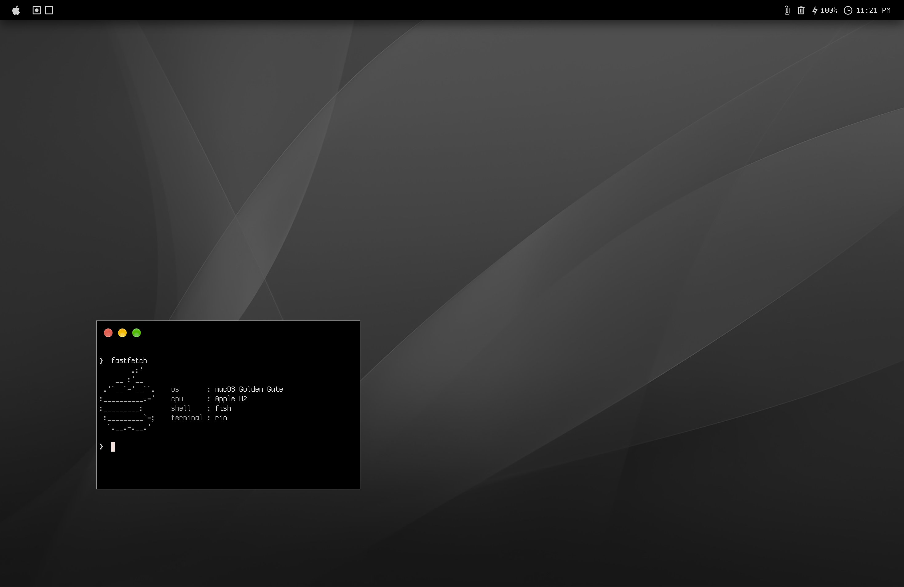

# ✦ Dotfiles & Rice

This repo exists to save the configuration and image of my working machine, so I can rebuild it later if needed. Feel free to use anything you need.

> → I moved from Nix package manager back to Brew (and its Brewfile) because of the complexity Nix was bringing to the system.<br>
> → I moved from Kitty terminal emulator to Ghostty, then from Ghostty to Rio because of Kitty's and Ghostty's slower perfomance I experienced after updating to 0.49.2 (kitty) and 1.4.0 (ghostty).

## ⟡ Directory structure

```
~/
│
├── README.md
├── LICENSE
├── .gitignore
├── result.png
│
├── .environment/
│   ├── instructions.txt   # all the necessary instructions
│   ├── packages/...       # brew bundle management
│   ├── bin/...            # custom binaries
│   ├── wallpapers/...     # favorite wallpapers
│   └── misc/...           # different types of important files
│
└── .config/...            # directories with configurations
```

## ⟡ Instruction

1. Copy directories `.environment` and `.config` into your home directory (`~`)
2. Run these commands:

    ```bash
    # Install Brew (if not already present)
    /bin/bash -c "$(curl -fsSL https://raw.githubusercontent.com/Homebrew/install/HEAD/install.sh)"
    eval "$(/opt/homebrew/bin/brew shellenv)"

    # Move to the necessary directory
    cd ~/.environment/packages/

    # Apply bundle (Brewfile) configuration & Remove odd binaries
    brew bundle install
    brew bundle cleanup --force
    ```

3. Later aliases from the fish config become available.

## ⟡ Customization from Fish

###### Path hierarchy
1. `$HOME/.environment/bin` - custom binaries
2. `/opt/homebrew/bin`      - system-wide homebrew packages

###### Short brew commands

| Command | Purpose | Raw version |
|---------|---------|-------------|
| `bb-install` | Installs binaries according to the Brewfile                 | `brew bundle --file=~/.environment/packages/Brewfile` |
| `bb-prune`   | Prunes binaries that are not from the Brewfile              | `brew bundle --file=~/.environment/packages/Brewfile --force cleanup` |
| `bb-trust`   | Trusts taps from the Brewfile via the bash script           | `source ~/.environment/packages/Trust-list` |
| `bb-sync`    | Both prunes and installs binaries according to the Brewfile | `bb-trust && bb-prune && bb-install` |
| **Daemons** | | |
| `nudge`      | Starts a daemon                                             | `brew services start` |
| `kick`       | Restarts a daemon                                           | `brew services restart` |
| `slap`       | Stops a daemon                                              | `brew services stop` |

## ⟡ AI / borrowed / original content
$\color{#a6e3a1}{✌︎}$ The readme was written by hand<br>
$\color{#a6e3a1}{✌︎}$ All the config files were written by hand<br>
$\color{#a6e3a1}{✌︎}$ mpv configuration is one's project from the github<br>
$\color{#a6e3a1}{✌︎}$ "Noir" wallpapers were downloaded from the internet<br>
$\color{#f38ba8}{⚙︎}$ "Amoled" wallpapers were generated by AI<br>
$\color{#f38ba8}{⚙︎}$ wallen script was developed with the heavy AI influence<br>
$\color{#f9e2af}{⚒}$ muz script was developed with an AI assistance

## ⟡ Result

